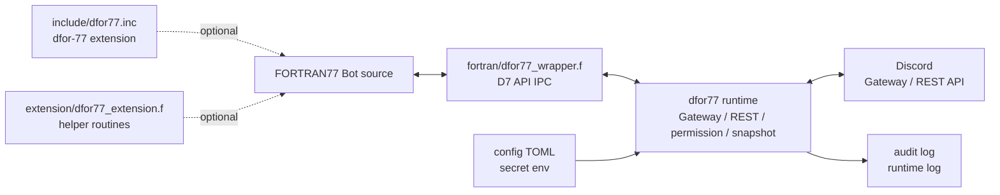

# dfor-77

## プログラムの目的

dfor-77は，FORTRAN77（ANSI X3.9-1978 言語標準）によってDiscord Botを作るためのruntimeおよびAPI wrapperである．
目標は，JavaScript や Python を使用したときに近いBot作成体験を，FORTRAN77でも提供することである．

このプログラムは，ANSI X3.9-1978言語標準に従うBotプログラムから利用可能なAPI群およびruntime連携機構からなる `dfor-77` と，いくつかの言語拡張機能をサポートしてBotプログラムの作成を容易または柔軟にする `dfor-77 extension` からなる．このプログラム上で提供可能なすべてのDiscord機能は，`dfor-77` だけで利用可能でなければならず，`dfor-77 extension` にのみ存在する必須機能は実装しない．

`dfor-77 extension` を含めた全体は，基本的に `dfor-77` というプロダクト名にはならない．全体に言及する際は，`dfor-77` と `dfor-77 extension`，またはこのプログラム全体と呼ぶ．


---

dfor-77 dfor-77 extensionは開発中です．v0.3.0時点の各種ドキュメントは，生成AIにより作成され，レビューが不十分な箇所があります．

---


## 開発者向けドキュメント

このプログラム自体の詳細は [DEVELOPMENT.md](DEVELOPMENT.md) を参照する．

## Bot作成者向けドキュメント

### 概要



### リポジトリ

| Path | 用途 |
| --- | --- |
| `.gitignore` | Git管理から除外する生成物，ローカル運用ファイル，secret類の指定 |
| `CHANGELOG.md` | releaseごとの変更履歴 |
| `COPYING`, `COPYING.LESSER` | ライセンス |
| `Cargo.lock` | Rust依存関係のlockfile |
| `Cargo.toml` | Rust crate manifest，公開crate同梱file list，package metadata |
| `DEVELOPMENT.md` | 開発者向けドキュメント |
| `Makefile` | build，test，package，staging検証用のmake target定義 |
| `README.md` | Bot作成者向けドキュメント |
| `SECURITY.md` | セキュリティポリシ |
| `.github/workflows/ci.yml` | GitHub Actions CI定義 |
| `config/dfor77.sample.toml` | 設定サンプル |
| `examples/` | サンプルBot |
| `extension/dfor77_extension.f` | `dfor-77 extension` のquery，payload，data URI helper |
| `fortran/dfor77_wrapper.f` | FORTRAN77標準Botからruntime IPCを呼ぶ `dfor-77` wrapper |
| `include/dfor77.inc` | `dfor-77 extension` の定数include |
| `src/` | Rust runtime，CLI，Gateway，REST，permission，snapshot，audit実装 |
| `tests/` | 開発用integration/source/license/config policy test |

### スタートガイド

1. FORTRANでBotプログラムを作成する |
1. runtime binaryをビルドする |
1. Botプログラムと `fortran/dfor77_wrapper.f` をコンパイルする |
1. mock Gateway eventでBotとruntimeのIPCを確認する．省略可 |
1. 設定ファイルと環境変数を用意する．デプロイ時に設定できる場合は省略可 |
1. 実際にDiscordと接続してGateway，REST，auditを確認する．省略可，運用前の確認として推奨 |
1. 配置先へruntime binary，Bot binary，設定，実行用ディレクトリを置く |
1. process manager，container，または任意の常駐方法でruntimeを起動する |

#### 必要なもの

| 名前 | 用途 |
| --- | --- |
| dfor-77 repository | このリポジトリ．runtime，FORTRAN wrapper，設定サンプルを使う |
| Git | dfor-77リポジトリをcloneする |
| Rust / Cargo 1.85+ | runtime binaryをbuildする |
| gfortran | Botプログラムとwrapperをコンパイルする |
| FORTRAN Bot プログラム | 利用者が作成するFORTRAN77のBotプログラム．Botの処理本体を書く |
| `config/dfor77.sample.toml` | Gateway，REST，audit，snapshotを設定するfileの基にする |
| `DISCORD_BOT_TOKEN` | Discord Bot tokenをruntimeへ渡す環境変数 |
| `DFOR77_AUDIT_HASH_KEY` | audit logでmessage content等をhash化する鍵を渡す環境変数 |
| Discord application | Discord Developer Portalで作成するapplication |
| Discord Bot | Discord applicationに紐づくBot user |
| Discord server | Botを追加してDiscordと接続し，運用に使うserver |
| session directory | Gateway resume用のsession情報を置くdirectory |
| log directory | audit logとruntime logを出力するdirectory |
| hot restart file | Bot process入れ替えのtriggerに使うfile |
| Linux server | runtime binaryとBot binaryを実行する配置先 |
| container | runtime binaryとBot binaryを実行する配置先 |

#### 0.導入

dfor-77を使うためのいくつかのパッケージを導入する．必要な部分のみ参考にすること．

以下では作業用ディレクトリを `$HOME/makeabot` と仮定する．実環境では，書き込み可能な任意のディレクトリへ置き換えてよい．

##### Linux（WSLを含む）

Debian / Ubuntu系環境では，Git，curl，証明書，C toolchain，gfortran，pkg-config，OpenSSL開発headerを導入する．
```sh
sudo apt update
sudo apt install -y git curl ca-certificates build-essential gfortran pkg-config libssl-dev
```

Rust / Cargo 1.85以上を導入する．インストールについては，[公式サイト](https://rust-lang.org/tools/install/)も参考にすること．
```sh
curl --proto '=https' --tlsv1.2 -sSf https://sh.rustup.rs | sh
source "$HOME/.cargo/env"
rustup update stable
rustup default stable
```

dfor-77 のリポジトリを `$HOME/makeabot` にcloneする．
```sh
mkdir -p "$HOME/makeabot"
cd "$HOME/makeabot"
git clone https://github.com/himarho/dfor-77.git
cd "$HOME/makeabot/dfor-77"
```

##### macOS

Xcode Command Line Toolsを導入する．
```sh
xcode-select --install
```

Homebrewを導入する．
```sh
/bin/bash -c "$(curl -fsSL https://raw.githubusercontent.com/Homebrew/install/HEAD/install.sh)"
```

Gitとgfortranを導入する．Homebrewでは `gcc` formulaにgfortranが含まれる．
```sh
brew install git gcc
```

Rust / Cargo 1.85以上を導入する．
```sh
curl --proto '=https' --tlsv1.2 -sSf https://sh.rustup.rs | sh
source "$HOME/.cargo/env"
rustup update stable
rustup default stable
```

dfor-77 リポジトリを `$HOME/makeabot` にcloneする．
```sh
mkdir -p "$HOME/makeabot"
cd "$HOME/makeabot"
git clone https://github.com/himarho/dfor-77.git
cd "$HOME/makeabot/dfor-77"
```

##### 導入を確認する

使用するtoolchainと作業ディレクトリを確認する．
```sh
pwd
git --version
cargo --version
gfortran --version
```

#### 1. Botプログラムの作成

FORTRAN77の標準に従うBotでは `INCLUDE` を使わず，必要な定数をプログラム内の `PARAMETER` として置く．ここでは，message contentが `ping` と完全一致した場合に，同じchannelへ `pong!` と返すBotを作る．

ここでは利用者が作成するBot プログラムの名前を `mybot.f` とする．任意のエディタで `mybot.f` を作成し，次の内容を書く．

```fortran
      PROGRAM PINGBT

      INTEGER D7OK,D7EOF,D7TIM,D7MSG
      PARAMETER (D7OK=0,D7EOF=1,D7TIM=51,D7MSG=101)
      INTEGER STAT, EVNT, CLEN, TLEN, TRUN, BOT
      CHARACTER*32 CHID
      CHARACTER*64 TEXT
      CHARACTER*5 REPLY
      DATA REPLY /'pong!'/

      CALL D7INI(STAT)
      IF (STAT .NE. D7OK) STOP 1

  100 CALL D7NXT(EVNT, STAT)
      IF (STAT .EQ. D7TIM) GOTO 100
      IF (STAT .EQ. D7EOF) GOTO 900
      IF (STAT .NE. D7OK) GOTO 100
      IF (EVNT .NE. D7MSG) GOTO 100

      CALL D7BOT(BOT, STAT)
      IF (STAT .NE. D7OK) GOTO 100
      IF (BOT .NE. 0) GOTO 100

      CALL D7TXT(TEXT, 64, TLEN, TRUN, STAT)
      IF (STAT .NE. D7OK) GOTO 100
      IF (TLEN .NE. 4) GOTO 100
      IF (TEXT(1:4) .NE. 'ping') GOTO 100

      CALL D7CHN(CHID, 32, CLEN, TRUN, STAT)
      IF (STAT .NE. D7OK) GOTO 100
      CALL D7SND(CHID, CLEN, REPLY, 5, STAT)
      GOTO 100

  900 CALL D7END(STAT)
      STOP
      END
```

このBotは `D7NXT` でGateway eventを待機し，`D7MSG` のときだけ処理する．`D7BOT` でBot自身や他Botのmessageを除外し，`D7TXT` でmessage contentを取得する．contentが `ping` であれば，`D7CHN` で取得したchannel IDを使って `D7SND` により `pong!` を送信する．

この例ではchannel IDによる制限を行わない．そのため，runtimeに届いた人間の `MESSAGE_CREATE` のうち，message contentが完全に `ping` であるものへ反応する．特定のchannelだけで反応させたい場合は，`D7CHN` で得た `CHID` と許可するchannel IDを比較し，一致しない場合は `D7SND` を呼ばずにevent loopへ戻る．

`mybot.f` の各行は次の役割を持つ．

| 行 | 内容 | 説明 |
| --- | --- | --- |
| 1 | `PROGRAM PINGBT` | FORTRANプログラムを開始し，プログラム名を `PINGBT` とする． |
| 2 | 空行 | 宣言部を読みやすくするための区切り． |
| 3 | `INTEGER D7OK,D7EOF,D7TIM,D7MSG` | dfor-77のstatus値とevent値を整数定数として使うために宣言する． |
| 4 | `PARAMETER (D7OK=0,D7EOF=1,D7TIM=51,D7MSG=101)` | `D7OK`，`D7EOF`，`D7TIM`，`D7MSG` の値をBot source内で定義する． |
| 5 | `INTEGER STAT, EVNT, CLEN, TLEN, TRUN, BOT` | runtime API呼び出しで使うstatus，event，文字列長，切り詰め有無，Bot判定を保持する変数を宣言する． |
| 6 | `CHARACTER*32 CHID` | message送信先channel IDを受け取る文字列bufferを宣言する． |
| 7 | `CHARACTER*64 TEXT` | message contentを受け取る文字列bufferを宣言する． |
| 8 | `CHARACTER*5 REPLY` | 返信内容 `pong!` を保持する文字列を宣言する． |
| 9 | `DATA REPLY /'pong!'/` | 返信内容を `pong!` に初期化する． |
| 10 | 空行 | 初期化処理の前の区切り． |
| 11 | `CALL D7INI(STAT)` | dfor-77 runtimeとのIPCを初期化する．結果は `STAT` に入る． |
| 12 | `IF (STAT .NE. D7OK) STOP 1` | 初期化に失敗した場合は終了する． |
| 13 | 空行 | event loopの前の区切り． |
| 14 | `100 CALL D7NXT(EVNT, STAT)` | label `100` からevent loopを開始し，次のGateway eventを取得する． |
| 15 | `IF (STAT .EQ. D7TIM) GOTO 100` | event待ちがtimeoutした場合は，終了せずに次のevent待ちへ戻る． |
| 16 | `IF (STAT .EQ. D7EOF) GOTO 900` | runtimeから終了が通知された場合は，終了処理へ進む． |
| 17 | `IF (STAT .NE. D7OK) GOTO 100` | その他の取得失敗は無視し，event loopを継続する． |
| 18 | `IF (EVNT .NE. D7MSG) GOTO 100` | message作成event以外は処理せず，event loopへ戻る． |
| 19 | 空行 | Bot判定処理の前の区切り． |
| 20 | `CALL D7BOT(BOT, STAT)` | 現在のmessageがBot由来かどうかを取得する． |
| 21 | `IF (STAT .NE. D7OK) GOTO 100` | Bot判定に失敗した場合は処理せず，event loopへ戻る． |
| 22 | `IF (BOT .NE. 0) GOTO 100` | Bot自身や他Botのmessageであれば返信しない． |
| 23 | 空行 | message content判定の前の区切り． |
| 24 | `CALL D7TXT(TEXT, 64, TLEN, TRUN, STAT)` | message contentを `TEXT` に取得し，実際のbyte長を `TLEN` に受け取る． |
| 25 | `IF (STAT .NE. D7OK) GOTO 100` | message content取得に失敗した場合は処理せず，event loopへ戻る． |
| 26 | `IF (TLEN .NE. 4) GOTO 100` | content長が `ping` の4 byteでなければ返信しない． |
| 27 | `IF (TEXT(1:4) .NE. 'ping') GOTO 100` | 先頭4文字が `ping` と一致しなければ返信しない． |
| 28 | 空行 | 返信処理の前の区切り． |
| 29 | `CALL D7CHN(CHID, 32, CLEN, TRUN, STAT)` | eventが発生したchannel IDを `CHID` に取得する． |
| 30 | `IF (STAT .NE. D7OK) GOTO 100` | channel ID取得に失敗した場合は返信せず，event loopへ戻る． |
| 31 | `CALL D7SND(CHID, CLEN, REPLY, 5, STAT)` | 取得したchannelへ `pong!` を送信する． |
| 32 | `GOTO 100` | 返信後，次のeventを待つためevent loopへ戻る． |
| 33 | 空行 | 終了処理の前の区切り． |
| 34 | `900 CALL D7END(STAT)` | label `900` でruntimeとのIPCを終了する． |
| 35 | `STOP` | Bot programを正常終了する． |
| 36 | `END` | FORTRAN programを閉じる． |

`dfor-77 extension` を使えるFORTRAN環境では，定数定義をプログラム内へ手動で置く代わりに，`include/dfor77.inc` を `INCLUDE` で取り込める．同じ `ping` / `pong!` Botをextensionとして書く場合は，任意のエディタで `mybot_extension.f` を作成し，次の内容を書く．

```fortran
      PROGRAM PINGEX
      INCLUDE 'dfor77.inc'

      INTEGER STAT, EVNT, CLEN, TLEN, TRUN, BOT
      CHARACTER*32 CHID
      CHARACTER*64 TEXT
      CHARACTER*5 REPLY
      DATA REPLY /'pong!'/

      CALL D7INI(STAT)
      IF (STAT .NE. D7OK) STOP 1

  100 CALL D7NXT(EVNT, STAT)
      IF (STAT .EQ. D7TIM) GOTO 100
      IF (STAT .EQ. D7EOF) GOTO 900
      IF (STAT .NE. D7OK) GOTO 100
      IF (EVNT .NE. D7MSG) GOTO 100

      CALL D7BOT(BOT, STAT)
      IF (STAT .NE. D7OK) GOTO 100
      IF (BOT .NE. 0) GOTO 100

      CALL D7TXT(TEXT, 64, TLEN, TRUN, STAT)
      IF (STAT .NE. D7OK) GOTO 100
      IF (TLEN .NE. 4) GOTO 100
      IF (TEXT(1:4) .NE. 'ping') GOTO 100

      CALL D7CHN(CHID, 32, CLEN, TRUN, STAT)
      IF (STAT .NE. D7OK) GOTO 100
      CALL D7SND(CHID, CLEN, REPLY, 5, STAT)
      GOTO 100

  900 CALL D7END(STAT)
      STOP
      END
```

このextension版では，`D7OK`，`D7EOF`，`D7TIM`，`D7MSG` などの定数を `include/dfor77.inc` から読み込む．Bot本体のevent loop，Bot判定，message content判定，返信処理は標準版と同じである．標準FORTRAN77だけで書く場合は先の `mybot.f` のように，`INCLUDE` を使える拡張FORTRAN77環境では `mybot_extension.f` のように書ける．

#### 2. runtime binaryのビルド

dfor-77のruntimeはRustで実装されている．このruntime binaryがDiscord Gateway接続，REST送信，rate limit，permission判定，audit記録，Bot processの起動とIPCを担当する．

この手順は，repository rootである `$HOME/makeabot/dfor-77` で実行する．ここで作成するruntime binaryは，ローカル確認ではそのまま `target/release/dfor77` として使い，デプロイ時には配置先の実行用directoryへコピーする．

| 種別 | Path |
| --- | --- |
| 作業directory | `$HOME/makeabot/dfor-77` |
| 入力 | `Cargo.toml`，`Cargo.lock`，`src/` |
| 生成directory | `target/release/` |
| 主な生成file | `target/release/dfor77` |
| デプロイ時に配置するfile | `target/release/dfor77` |

次のコマンドでrelease buildを行う．
```sh
cargo build --release
```

成功すると `target/release/dfor77` が作成される．`target/release/` には中間生成物も作られるが，通常のデプロイで必要なのはruntime binaryである `target/release/dfor77` である．

| 要素 | 説明 |
| --- | --- |
| `cargo` | Rust package manager兼build tool． |
| `build` | crateをbuildするCargo subcommand． |
| `--release` | 最適化されたrelease profileでbuildする指定． |
| `target/release/dfor77` | build後に作成されるruntime binary． |

ビルド後，runtime binaryが作成されたことを確認する．
```sh
test -x target/release/dfor77
target/release/dfor77 --help
```

#### 3. Botプログラムのコンパイル

BotプログラムはFORTRAN sourceであり，runtime binaryとは別のBot binaryとしてコンパイルする．ここでは，`mybot.f` と `fortran/dfor77_wrapper.f` を一緒にgfortranへ渡し，`target/fortran/mybot` を作成する．

この手順も `$HOME/makeabot/dfor-77` で実行する．Bot sourceはrepository rootに置いた `mybot.f` とし，生成されるBot binaryは `target/fortran/` に置く．

| 種別 | 標準Bot |
| --- | --- | --- |
| 作業directory | `$HOME/makeabot/dfor-77` |
| Bot source | `mybot.f` |
| 入力 | `fortran/dfor77_wrapper.f` |
| 生成directory | `target/fortran/` |
| 生成file | `target/fortran/mybot` |
| デプロイ時に配置するfile | `target/fortran/mybot` |

```sh
mkdir -p target/fortran
gfortran -std=legacy -ffixed-line-length-72 mybot.f fortran/dfor77_wrapper.f -o target/fortran/mybot
```

このコマンドは，次の内容を指定している．

| 要素 | 説明 |
| --- | --- |
| `mkdir -p target/fortran` | Bot binaryの出力先directoryを作成する．既に存在する場合も失敗しない． |
| `gfortran` | FORTRAN compiler． |
| `-std=legacy` | 固定形式FORTRAN sourceを実用的にbuildするためのgfortran指定． |
| `-ffixed-line-length-72` | 固定形式FORTRANの有効桁を72桁にする指定． |
| `mybot.f` | 利用者が作成したBotプログラム本体． |
| `fortran/dfor77_wrapper.f` | Botプログラムからdfor-77 runtime IPCを呼ぶwrapper． |
| `-o target/fortran/mybot` | 出力するBot binaryのpath． |

成功すると `target/fortran/mybot` が作成される．
```sh
test -x target/fortran/mybot
```

`dfor-77 extension` のincludeやhelperを使うBotでは，標準のコンパイルコマンドに `-Iinclude` と `extension/dfor77_extension.f` を追加する．ここでは，入力を `mybot_extension.f`，出力を `target/fortran/mybot_extension` として示す．
```sh
mkdir -p target/fortran
gfortran -std=legacy -ffixed-line-length-72 -Iinclude mybot_extension.f fortran/dfor77_wrapper.f extension/dfor77_extension.f -o target/fortran/mybot_extension
```

extensionを使う場合の追加要素は次のとおりである．
| 要素 | 説明 |
| --- | --- |
| `-Iinclude` | `INCLUDE 'dfor77.inc'` を使う場合に，include directoryをcompilerへ渡す． |
| `mybot_extension.f` | 手順1で作成したextension版Bot source． |
| `extension/dfor77_extension.f` | query，payload，data URI helperなどのextension routineをlinkする． |
| `-o target/fortran/mybot_extension` | extension版Bot binaryの出力先path． |

#### 4. mock Gateway eventでの確認

実際にDiscordと接続する前に，mock Gateway eventでBot processとruntimeのIPCを確認できる．mock Gateway eventは，保存されたGateway eventをruntimeへ入力するためのfileである．ここでは `ping` messageを含む `mock-ping.jsonl` を作り，Bot binaryがruntimeからeventを受け取って `D7SND` を要求するかを確認する．

任意のエディタで `mock-ping.jsonl` を作成し，次の内容を書く．JSON Lines形式なので，1行が1つのGateway eventである．
```json
{"op":0,"s":1,"t":"READY","d":{"session_id":"ping-session","resume_gateway_url":"wss://gateway.discord.gg/?v=10&encoding=json","user":{"id":"100000000000000009"}}}
{"op":0,"s":2,"t":"GUILD_CREATE","d":{"id":"100000000000000001","owner_id":"100000000000000009","channels":[{"id":"100000000000000002","type":0,"parent_id":null}],"roles":[{"id":"100000000000000001","permissions":"0","position":0}],"members":[{"user":{"id":"100000000000000009"},"roles":[],"communication_disabled_until":null},{"user":{"id":"100000000000000004"},"roles":[],"communication_disabled_until":null}]}}
{"op":0,"s":3,"t":"MESSAGE_CREATE","d":{"guild_id":"100000000000000001","channel_id":"100000000000000002","id":"100000000000000003","content":"ping","type":0,"attachments":[],"author":{"id":"100000000000000004","bot":false},"member":{"roles":[]}}}
```

次のコマンドで，mock eventを入力し，REST送信はdry-runとしてaudit logへ記録する．
```sh
target/release/dfor77 --mock-gateway ./mock-ping.jsonl --audit-log /tmp/dfor77-audit.jsonl --runtime-log /tmp/dfor77-runtime.jsonl --dry-run --bot target/fortran/mybot
```

このコマンドは，次の内容を指定している．

| 要素 | 説明 |
| --- | --- |
| `target/release/dfor77` | 手順2でbuildしたruntime binary． |
| `--mock-gateway ./mock-ping.jsonl` | Discordとは接続せず，file内のmock Gateway eventを入力にする． |
| `--audit-log /tmp/dfor77-audit.jsonl` | REST actionの監査ログを書き出す． |
| `--runtime-log /tmp/dfor77-runtime.jsonl` | Gateway遷移やBot lifecycleのruntime logを書き出す． |
| `--dry-run` | 実REST送信を行わず，REST actionを検証用に記録する． |
| `--bot target/fortran/mybot` | 手順3でコンパイルしたBot binaryをruntimeから起動する． |

mock event処理後もBotは次のeventを待機する．`MESSAGE_CREATE` の処理を確認したら，端末で `Ctrl-C` により停止する．

停止後，監査ログとruntime logを検査する．
```sh
target/release/dfor77 --validate-audit-log /tmp/dfor77-audit.jsonl --audit-require-action D7SND
target/release/dfor77 --validate-runtime-log /tmp/dfor77-runtime.jsonl
```

`--validate-audit-log` はaudit logに明確なsecret混入がないか，JSONLとして読めるかを確認する．
`--audit-require-action D7SND` は，`ping` に対して送信actionが記録されたことを確認する指定である．
`--validate-runtime-log` はruntime logのschemaと基本的な内容を確認する．

#### 5. 設定fileと環境変数の用意

実際にDiscordと接続する前に，設定fileとsecretを用意する．設定fileは `config/dfor77.sample.toml` を基に作る．Bot tokenやaudit hash keyはsecretであり，設定fileへ書かず，環境変数でruntimeへ渡す．適当なsecret管理ツールや機能がある場合はそれらを使用してもよい．

この手順では，repository rootにローカル用設定file `dfor77.local.toml` を作る．このfileは配置先にも必要であるが，secretそのものは書かない．

```sh
cp config/dfor77.sample.toml ./dfor77.local.toml
export DISCORD_BOT_TOKEN='...'
export DFOR77_AUDIT_HASH_KEY="$(dd if=/dev/urandom bs=32 count=1 2>/dev/null | base64)"
target/release/dfor77 --validate-config --config ./dfor77.local.toml
```

これらのコマンドは，次の内容を行う．

| 要素 | 説明 |
| --- | --- |
| `cp config/dfor77.sample.toml ./dfor77.local.toml` | 公開用sampleからローカル用設定fileを作る． |
| `DISCORD_BOT_TOKEN` | Discord Bot tokenをruntimeへ渡す環境変数． |
| `DFOR77_AUDIT_HASH_KEY` | audit logでmessage content等をhash化するための鍵を渡す環境変数． |
| `--validate-config --config ./dfor77.local.toml` | 設定fileを読み，起動前に構成を検査する． |

`dfor77.local.toml` はローカル設定fileである．公開repositoryへ入れず，実運用では配置先ごとに管理する．

`dfor77.local.toml` で最初に確認する項目は次である．初回の `ping` / `pong!` 確認では，基本的に `config/dfor77.sample.toml` の値をそのまま使える．

| section | key | 初回確認での扱い |
| --- | --- | --- |
| `discord` | `token_env` | `DISCORD_BOT_TOKEN` のままにする．token本体はfileへ書かない． |
| `discord` | `intents` | `GUILDS`，`GUILD_MESSAGES`，`MESSAGE_CONTENT` を含める．`ping` の本文を読むために `MESSAGE_CONTENT` が必要である． |
| `gateway` | `live` | 実際にDiscordと接続する場合は `true` にする． |
| `rest` | `base_url` | 通常は `https://discord.com` のままにする． |
| `audit` | `hash_key_env` | `DFOR77_AUDIT_HASH_KEY` のままにする．hash key本体はfileへ書かない． |
| `audit` | `path` | command lineの `--audit-log` を使う場合，起動時の指定が優先される． |
| `runtime` | `log_path` | command lineの `--runtime-log` を使う場合，起動時の指定が優先される． |
| `mode` | `dry_run` | 実際にREST送信を行う確認では `false` にする． |

`DISCORD_BOT_TOKEN` はBot tokenであり，実際の値を設定する．`DFOR77_AUDIT_HASH_KEY` はaudit logでmessage content等をhash化するための秘密鍵であり，Discordから取得する値ではない．十分に長いランダム文字列を自分で作る．上の例では `/dev/urandom` から32 byteを読み，base64文字列として環境変数へ入れている．

#### 6. Discordへの接続

実際にDiscordと接続する場合は，Bot tokenとaudit hash keyを環境変数で渡した状態でruntimeを起動する．起動前に，Gateway session保存先とlog出力先を作成する．
なお，Discord Developer Portal でのApplicationの作成，Bot tokenなどの取得は解説しない．

この手順はローカル確認用であり，repository rootの下に `var/dfor77/` を作る．ここで生成されるsession fileとlog fileはローカル運用状態であり，公開repositoryへ入れない．

dfor-77の通常のGateway型Botは，runtime側からDiscordへ外向きに接続する．そのため，ローカルPCや自宅routerのport開放は通常不要である．必要なのは，配置先から `discord.com` と `gateway.discord.gg` へ外向きのHTTPS / WebSocket通信ができることである．HTTP interaction receiverや外部から呼ばれる管理endpointを自分で公開する構成にしない限り，DiscordからローカルPCへ着信させるportは使わない．

| 種別 | Path |
| --- | --- |
| 作業directory | `$HOME/makeabot/dfor-77` |
| runtime binary | `target/release/dfor77` |
| Bot binary | `target/fortran/mybot` |
| 設定file | `dfor77.local.toml` |
| 生成directory | `var/dfor77/sessions`，`var/dfor77/log` |
| 生成file | `var/dfor77/log/audit.jsonl`，`var/dfor77/log/runtime.jsonl` |
| 使用file path | `var/dfor77/restart` |
| Git管理 | `dfor77.local.toml` と `var/dfor77/` はローカル用として扱う |

```sh
mkdir -p var/dfor77/sessions var/dfor77/log

target/release/dfor77 \
  --config ./dfor77.local.toml \
  --audit-log var/dfor77/log/audit.jsonl \
  --runtime-log var/dfor77/log/runtime.jsonl \
  --gateway-session-dir var/dfor77/sessions \
  --hot-restart-file var/dfor77/restart \
  --bot target/fortran/mybot
```

この起動commandでは，次のpathとoptionを使う．

| 要素 | 説明 |
| --- | --- |
| `var/dfor77/sessions` | Gateway Resumeに使うsession情報の保存先． |
| `var/dfor77/log` | audit logとruntime logの出力directory． |
| `--config ./dfor77.local.toml` | 手順5で用意した設定fileを使う． |
| `--audit-log var/dfor77/log/audit.jsonl` | REST actionの監査ログをJSONLで出力する． |
| `--runtime-log var/dfor77/log/runtime.jsonl` | Gateway遷移やBot lifecycleをJSONLで出力する． |
| `--gateway-session-dir var/dfor77/sessions` | Gateway Resume用sessionを保存する． |
| `--hot-restart-file var/dfor77/restart` | Bot process入れ替えのtrigger fileを指定する． |
| `--bot target/fortran/mybot` | 起動するBot binaryを指定する． |

起動後，Discord側でBotがonlineになり，対象serverで `ping` と送信したときに `pong!` が返れば，Gateway受信，Bot IPC，REST送信の基本経路が動いている．

`pong!` が返らない場合は，まず `var/dfor77/log/runtime.jsonl` と `var/dfor77/log/audit.jsonl` を確認する．Botがonlineにならない場合はGateway接続またはtokenを疑う．Botがonlineで，message送信後もaudit logに `D7SND` が出ない場合は，message contentがruntimeへ届いていない，Botがそのchannelを見られない，またはBotプログラムの条件に一致していない可能性がある．audit logに `D7SND` が出て失敗している場合は，送信権限やREST応答を確認する．

#### 7. 本番環境へのデプロイ

デプロイでは，開発環境で確認したruntime binary，Bot binary，設定file，実行用directoryを配置先へ置く．配置先はLinux server，container，systemd service，supervisor管理processなど，常駐processを動かせる環境を想定する．runtime binaryとBot binaryは，配置先と同じOSおよびCPU architecture向けにビルドする．別OSへ配置する場合は，配置先上または同等環境でビルドする．

ローカル確認では `target/` 配下の生成物をそのまま使えるが，運用ではrepository checkoutやbuild用directoryとは別に，実行用directoryを決めて配置する．ここでは配置先の例を `/opt/dfor77-pingbot` とする．
`/opt/dfor77-pingbot` は説明用の配置例であり，固定の既定値ではない．書き込み権限がない環境では，`$HOME/dfor77-pingbot` など利用者が書き込めるdirectoryに置き換えてよい．その場合は，表と起動command内の `/opt/dfor77-pingbot` を選んだdirectoryへ読み替える．systemdなどで常駐させる場合は，実行userが `var/sessions` と `var/log` へ書き込めるようにする．

| 種別 | 開発環境でのpath | 配置先でのpath例 |
| --- | --- |
| runtime binary | `target/release/dfor77` | `/opt/dfor77-pingbot/bin/dfor77` |
| Bot binary | `target/fortran/mybot` | `/opt/dfor77-pingbot/bin/mybot` |
| extension版Bot binary | `target/fortran/mybot_extension` | `/opt/dfor77-pingbot/bin/mybot_extension` |
| 設定file | `dfor77.local.toml` | `/opt/dfor77-pingbot/etc/dfor77.local.toml` |
| session directory | `var/dfor77/sessions` | `/opt/dfor77-pingbot/var/sessions` |
| audit log出力先 | `var/dfor77/log/audit.jsonl` | `/opt/dfor77-pingbot/var/log/audit.jsonl` |
| runtime log出力先 | `var/dfor77/log/runtime.jsonl` | `/opt/dfor77-pingbot/var/log/runtime.jsonl` |
| hot restart file path | `var/dfor77/restart` | `/opt/dfor77-pingbot/var/restart` |

配置後のdirectory構成は，例えば次のようにする．

```text
/opt/dfor77-pingbot/
  bin/
    dfor77
    mybot
  etc/
    dfor77.local.toml
  var/
    sessions/
    log/
      audit.jsonl
      runtime.jsonl
    restart
```

配置先で必要なdirectoryを作成し，build済みfileを置く．次の例では標準Botの `mybot` を配置する．extension版の場合は，`target/fortran/mybot_extension` を `/opt/dfor77-pingbot/bin/mybot_extension` に，起動時の `--bot` もそれぞれ読み替える．

```sh
mkdir -p /opt/dfor77-pingbot/bin
mkdir -p /opt/dfor77-pingbot/etc
mkdir -p /opt/dfor77-pingbot/var/sessions
mkdir -p /opt/dfor77-pingbot/var/log

cp target/release/dfor77 /opt/dfor77-pingbot/bin/dfor77
cp target/fortran/mybot /opt/dfor77-pingbot/bin/mybot
cp dfor77.local.toml /opt/dfor77-pingbot/etc/dfor77.local.toml
touch /opt/dfor77-pingbot/var/restart
```

secretは配置先の環境変数で渡す．設定ファイル，command line，log，repositoryにはBot tokenを書かない．

配置先での起動commandも，基本形は手順6と同じである．ただし，起動時のpathは開発環境の `target/` ではなく，配置先の `/opt/dfor77-pingbot` 配下を指す．

```sh
export DISCORD_BOT_TOKEN='...'
export DFOR77_AUDIT_HASH_KEY='...'

/opt/dfor77-pingbot/bin/dfor77 \
  --config /opt/dfor77-pingbot/etc/dfor77.local.toml \
  --audit-log /opt/dfor77-pingbot/var/log/audit.jsonl \
  --runtime-log /opt/dfor77-pingbot/var/log/runtime.jsonl \
  --gateway-session-dir /opt/dfor77-pingbot/var/sessions \
  --hot-restart-file /opt/dfor77-pingbot/var/restart \
  --bot /opt/dfor77-pingbot/bin/mybot
```

multi-shardで起動する場合は，runtime側にshard数を渡す．

```sh
export DISCORD_BOT_TOKEN='...'
export DFOR77_AUDIT_HASH_KEY='...'

/opt/dfor77-pingbot/bin/dfor77 \
  --config /opt/dfor77-pingbot/etc/dfor77.local.toml \
  --audit-log /opt/dfor77-pingbot/var/log/audit.jsonl \
  --runtime-log /opt/dfor77-pingbot/var/log/runtime.jsonl \
  --gateway-session-dir /opt/dfor77-pingbot/var/sessions \
  --hot-restart-file /opt/dfor77-pingbot/var/restart \
  --shards 4 \
  --bot /opt/dfor77-pingbot/bin/mybot
```

multi-shardでは，複数shardでGateway接続を分割する．小規模なBotでは通常不要であり，guild数や運用規模に応じて使う．

#### 8. runtimeを常駐起動する

手順7の起動commandで動作を確認したら，配置先の運用方法に合わせてruntimeを常駐起動する．使う仕組みは任意でよく，systemd，supervisor，container，Cloudflare Containersなど，長時間processを動かせる方法を選ぶ．

常駐化するときは，手動実行で使ったcommandと同じ引数をprocess managerやcontainer entrypointへ移す．Bot tokenとaudit hash keyは，service fileやimageに直接書かず，配置先のsecret管理または環境変数で渡す．runtimeを実行するuserは，`var/sessions`，`var/log`，hot restart fileの親directoryへ書き込める必要がある．

process manager側では，異常終了時に再起動する設定を使える．ただし，短時間で失敗を繰り返す場合に無制限再起動し続けないよう，restart間隔や最大試行回数を設定する．containerで動かす場合も同様に，log出力先，session directory，secret，外向きnetwork接続，disk使用量を確認する．

運用前の確認項目は次である．hot restart，multi-shard，長時間試験は，その機能を使う場合または無人運用へ進む場合に確認する．

| 項目 | 確認内容 |
| --- | --- |
| 起動 | process managerまたはcontainerからruntimeが起動し，Bot processも起動する |
| secret | Bot tokenとaudit hash keyが環境変数で渡され，設定file，command line，logに値が出ない |
| Gateway | READY後もevent loopが継続し，reconnect後も処理へ戻る |
| Bot処理 | 対象eventに対してBotプログラムが期待するactionを実行する |
| REST | REST actionの成功，失敗，rate limitがlogとauditに残る |
| permission | 権限不足時に意図しないREST actionを送らない |
| audit | token，Authorization header，message contentが設定通り保存されない |
| log | audit log，runtime log，stderrの保存先とrotationまたは削除方針を決める |
| resume | 有効な保存sessionがある再起動ではResumeを試し，正常終了や復帰不能通知の後は新規接続する |
| hot restart | hot restartを使う場合，hot restart file更新後にBot processが入れ替わる |
| multi-shard | multi-shardで起動する場合，shard数とrestart制限が意図どおりである |
| long run | 無人運用前に，heartbeat，rate limit，reconnect後のevent処理が継続することを長時間確認する |

### Bot作成リファレンス

この節は，スタートガイドで作成したBotを自分の用途へ変更するときの参照資料である．build手順やmock確認手順はスタートガイドを参照する．

ANSI X3.9-1978に沿ってBotを書く場合，`INCLUDE` は使わず，必要な定数をBot source内の `PARAMETER` として置く．`include/dfor77.inc` と `extension/dfor77_extension.f` は使わなくても，dfor-77本体のDiscord機能へ到達できる．

| 項目 | 方針 |
| --- | --- |
| source形式 | 固定形式FORTRAN sourceとして書く |
| 定数 | 使う値だけを `INTEGER` と `PARAMETER` でBot source内に置く |
| 標準出力 | dfor-77 runtimeとのIPC専用にする |
| 通常log | stderr，または `D7LOG` を使う |
| 初期化 | 最初に `D7INI` を呼び，失敗時は終了する |
| event loop | `D7NXT` でeventを待ち，`D7EOF` で終了処理へ進む |
| 終了処理 | 終了時に `D7END` を呼ぶ |
| 文字列 | NUL終端ではなく，明示したbyte長で渡す |
| 出力長 | getterの `OUTLEN` は完全なUTF-8 byte長，`TRUNC` は切り詰め有無を表す |

runtimeがstderrへ出す診断と `D7LOG` では，資格情報を伏せ字にし，改行や端末制御文字をそのまま出力しない．Unicodeの行区切りと文字方向制御は `[U+202E]` などの表記にし，metadata値の空白や区切り文字はpercent encodeする．日本語，アラビア語，絵文字などの通常の文字列と，長い `D7LOG` メッセージは維持する．audit logとruntime logのJSONでは制御文字をescapeするため，読み戻した元の値は変わらない．Rustから同じ処理を利用する場合は `diagnostic_text`，`diagnostic_field`，`write_diagnostic` と `audit::json_log_escape` を使える．

Botはeventを受け取ってから，必要なgetterで対象IDや本文を読む．たとえばmessage作成eventでは，`D7MSG` を判定したあとに `D7CHN`，`D7MID`，`D7USR`，`D7TXT`，`D7BOT` などを使う．Bot自身や他Botのmessageへ反応したくない場合は，`D7BOT` の結果を確認してからactionを実行する．

送信，削除，timeoutなどのDiscord操作はaction APIでruntimeへ要求する．runtimeはREST送信，rate limit，audit記録，可能な範囲のpermission preflightを担当する．Bot側では，各API呼び出し後の `STAT` を確認し，必要であれば `D7ERR` や `D7WHY` で直近の失敗理由を読む．

特定channelだけで反応させる場合は，`D7CHN` で取得したchannel IDとBot source内の許可channel IDを比較する．一致しない場合はactionを呼ばずにevent loopへ戻る．roleやuserで条件分岐する場合も同じ考え方で，`D7USR` や `D7RLC` / `D7RLI` で得た値を判定してからactionを呼ぶ．

DMを扱うBotでは `discord.intents = ["DIRECT_MESSAGES"]` とし，通常と同じ `D7NXT`，`D7TXT`，`D7CHN`，`D7SND` で受信と返信を行う．DM eventにはguild IDがないため `D7GID` は `D7STA` となる．DM channelの送信前判定はguild roleを要求せず，削除前判定ではBot自身のmessageだけを許可する．Discord側のDM拒否などは従来と同じREST errorで返す．Group DMの作成や管理は対象外である．

intentsには，reaction，typing，presence，poll，Auto Moderationなどの[公式Gateway intent名](https://docs.discord.com/developers/events/gateway#list-of-intents)も指定できる．旧名 `GUILD_BANS` と `GUILD_EMOJIS_AND_STICKERS` はそれぞれ `GUILD_MODERATION` と `GUILD_EXPRESSIONS` の別名として扱う．空配列も利用でき，未指定のeventを自動で購読することはない．privileged intentの利用にはDeveloper Portal側の許可が必要である．

### dfor-77 extensionリファレンス

`dfor-77 extension` は，標準FORTRAN77だけで書けるBotを便利にする追加層である．Discord機能へ到達するための必須経路ではない．標準Botでは `PARAMETER` をBot source内へ置き，extension Botでは `INCLUDE 'dfor77.inc'` により同じ定数を取り込める．

| 構成要素 | 用途 | 必須性 |
| --- | --- | --- |
| `include/dfor77.inc` | status，event，HTTP method，button styleなどの定数を取り込む | 任意 |
| `extension/dfor77_extension.f` | query，payload，data URIなどを組み立てるhelper routineを提供する | helperを使う場合のみ必要 |
| `-Iinclude` | compilerへinclude directoryを渡す | `INCLUDE 'dfor77.inc'` を使う場合のみ必要 |

extensionを使う場合も，runtimeとのIPCは `fortran/dfor77_wrapper.f` が担当する．`include/dfor77.inc` は定数の共有を簡単にするためのfileであり，runtimeと直接通信する実装ではない．helper routineを呼ぶBotでは，compile時に `extension/dfor77_extension.f` もlinkする．

| helper | 用途 |
| --- | --- |
| `D7XQ0`, `D7XQA` | REST read系endpointに渡すquery stringを生成する |
| `D7XACB` | `D7CMD` と同じapplication command payloadを生成する |
| `D7XAMK` | `D7AMK` と同じkeyword型Auto Moderation rule payloadを生成する |
| `D7XURI` | `D7URI` と同じ検証でbase64文字列からdata URIを生成する |
| `D7X64` | メモリ上のバイナリをbase64 data URIへ変換する |
| `D7XF64` | fileをbase64 data URIへ変換する |

### サンプルBot

`examples/sample_moderation/` には，dfor-77を使うBotプログラム例と，dfor-77 extensionを使うBotプログラム例を置く．これは利用者が動作やsource構造をより深く理解するためのサンプルであり，スタートガイドの `ping` / `pong!` Botとは別の例である．

サンプルBotの詳細は [examples/sample_moderation/README.md](examples/sample_moderation/README.md) を参照する．

### APIリファレンス

公開API名は `D7` で始まる英数字6文字以内の名前である．`D7X` prefixは `dfor-77 extension` helperに限る．FORTRAN wrapper内の非公開補助routineは `D7Z` prefixが使われる．

#### API分類

| 分類 | API |
| --- | --- |
| lifecycle | `D7INI`, `D7END`, `D7NXT`, `D7TYP`, `D7ENM` |
| event getter | `D7GID`, `D7CHN`, `D7CAT`, `D7MID`, `D7USR`, `D7EMJ`, `D7TXT`, `D7TAV`, `D7BOT`, `D7IMC`, `D7RLC`, `D7RLI` |
| snapshot utility | `D7MSF`, `D7MSI`, `D7SFD` |
| interaction getter | `D7IID`, `D7APP`, `D7ITK`, `D7INM`, `D7ITP` |
| preflight | `D7ADM`, `D7CAD`, `D7CDL`, `D7CTM`, `D7CSN`, `D7CDP`, `D7CTP`, `D7CSP` |
| message action | `D7SND`, `D7SJP`, `D7STK`, `D7POL`, `D7PAV`, `D7EPL`, `D7UPL`, `D7UPM`, `D7RAC`, `D7GRU`, `D7TPI`, `D7DEL`, `D7GMS`, `D7LMS`, `D7EMS`, `D7BMD`, `D7PIN` |
| member action | `D7TMO`, `D7UNT`, `D7AMR`, `D7RMR`, `D7EGM`, `D7KIK`, `D7BAN`, `D7UBN`, `D7GMB`, `D7LMB`, `D7SMB`, `D7AMB`, `D7ECM` |
| channel/role/guild | `D7CCR`, `D7ECH`, `D7DCH`, `D7CRO`, `D7ERO`, `D7DRO`, `D7EGD`, `D7GCH`, `D7CPM`, `D7DPM`, `D7GIN`, `D7CIN`, `D7FOL`, `D7SVC`, `D7GGD`, `D7GCS`, `D7MCP`, `D7ATH`, `D7LRO`, `D7RPS`, `D7GBN`, `D7LBN`, `D7BBN`, `D7AUD`, `D7AUM` |
| thread/webhook/user | `D7THR`, `D7CWH`, `D7LWH`, `D7GWH`, `D7EWH`, `D7DWH`, `D7WHP`, `D7WHM`, `D7GCU`, `D7GUR`, `D7CDM`, `D7GWB` |
| interaction/command | `D7ICB`, `D7ACR`, `D7IFU` |
| REST/Gateway raw | `D7RST`, `D7RBD`, `D7GWS`, `D7PRS`, `D7VST` |
| Gateway state | `D7GOP`, `D7GRT` |
| utility | `D7ERR`, `D7WHY`, `D7LOG`, `D7JES`, `D7B64`, `D7URI` |
| payload builder | `D7PEM`, `D7PE2`, `D7PBT`, `D7PAC`, `D7PSM`, `D7IMR`, `D7IDR`, `D7IMD`, `D7SCM`, `D7SCX`, `D7CMD`, `D7AMK` |
| extension helper | `D7XQ0`, `D7XQA`, `D7XACB`, `D7XAMK`, `D7XURI`, `D7XF64`, `D7X64` |

| 分類 | 使いどころ |
| --- | --- |
| lifecycle | Bot processの初期化，終了，event取得，event名取得 |
| event getter | 現在処理中のGateway eventからguild，channel，message，user，本文などを読む |
| snapshot utility | runtime snapshot上のmessageを短期検索し，Snowflake ID間の時刻差を読む |
| interaction getter | interaction ID，token，command名などを読む |
| preflight | REST実行前にruntime snapshot上で許可可能性を確認する |
| message action | message送信，削除，添付，reaction，pinなどを行う |
| member action | timeout，role操作，kick，ban，member取得などを行う |
| channel/role/guild | channel，role，guild，permission，invite，audit logなどを扱う |
| thread/webhook/user | thread，webhook，DM，user情報などを扱う |
| interaction/command | interaction callback，followup，application commandを扱う |
| REST/Gateway raw | typed API外のRESTやGateway payloadへ低レベルに到達する |
| Gateway state | Gateway resumeやoperation状態を読む |
| utility | 直近error，理由文字列，log，JSON escapeを扱う |
| payload builder | JSON payloadをFORTRAN側で組み立てる |
| extension helper | extension用のquery，payload，data URI helperを使う |

`D7CAD` は現在のサーバーメッセージの送信者が管理者またはサーバー所有者かを返す．イベントに権限フィールドがない場合は，`D7ADM` と同じメンバー，ロール，所有者の判定経路を使い，有効なキャッシュがなければ必要な情報をRESTで取得する．DMやメッセージ以外のイベントでは `D7STA` を返す．情報不足や取得失敗時も管理者判定の成功とはせず，`D7WHY` で詳細を確認できる．

メッセージに含まれる権限は `member_snapshot_ttl_ms` の期限内だけ利用する．対象guildのrole・guild更新，対象メンバーの更新・退出，RESTによる対象情報の再取得，GAPの発生後は，処理中・処理待ちのメッセージに残る古い権限を使わず，最新のsnapshotまたはRESTから判定し直す．無関係なguildや別メンバーの更新は，そのメッセージの権限を無効化しない．

RESTによるguild，role，member，banの更新が成功した場合や，送信後に結果が不明になった場合も，対象の権限情報を再取得する．guildの所有者，role削除後のメンバーのrole割り当ても確認し直す．channelの権限上書き，配置変更に伴う権限同期，Bot自身のthread参加状態の変更も，対象channelの再取得へ反映する．Botの権限やchannelに依存して確認したprivate threadへのアクセスも，関連する更新後は再確認する．未送信・拒否済みの操作でキャッシュを捨てたり，結果不明の更新を自動再送したりはしない．権限更新時は投稿履歴のsnapshotを維持する．guildやchannelの削除が確定した場合は関連するsnapshotも削除し，削除結果が不明な場合は再取得を可能にする．

`D7GRU(CHID, CLEN, MSGID, MLEN, EMOJI, ELEN, AFTER, ALEN, LIMIT, RTYPE, STATUS)` は，[指定した絵文字にリアクションしたユーザー](https://docs.discord.com/developers/resources/message#get-reactions)を取得する．`LIMIT` は1〜100，`RTYPE` は通常が `0`，burstが `1` である．最初のページは `AFTER=' '`，`ALEN=0` とし，続きは前のページの末尾のユーザーIDを渡す．IDは正の64bit整数の10進表記で指定する．絵文字は未encodeのUTF-8，custom emojiは `name:id` として渡し，`ELEN` にはbyte数を指定する．絵文字のURL encodeとqueryの組み立ては内部で行う．

`STATUS=D7OK` の場合，`D7RBD` でユーザー配列のJSON本文を読む．短いbufferでは `D7TRN` となり，大きなbufferで再取得できる．空のページは `[]` である．標準FORTRANから利用でき，extensionのincludeを使う場合は種別を `D7RNM`／`D7RBS` で指定できる．

`D7PAV(CHID, CLEN, MSGID, MLEN, ANSWER, AFTER, ALEN, LIMIT, STATUS)` は，[pollの指定回答へ投票したユーザー](https://docs.discord.com/developers/resources/poll#get-answer-voters)を取得する．`ANSWER` はDiscordから取得した非負の `INTEGER` 型の回答IDであり，配列の添字や1〜10の連番とは仮定しない．`LIMIT` は1〜100，最初のページは `AFTER=' '`，`ALEN=0` とする．続きは前のページの末尾のユーザーIDを渡す．成功後に `D7RBD` で読む本文は `{"users":[...]}` の形式であり，空のページは `{"users":[]}` となる．

`D7EPL(CHID, CLEN, MSGID, MLEN, STATUS)` は，[Bot自身が作成したpollを終了](https://docs.discord.com/developers/resources/poll#end-poll)する．他のユーザーのpollは終了できず，Discordからの拒否はstatusと `D7ERR` に反映する．成功後は `D7RBD` で更新後のmessageを取得できるが，正確な最終集計の完了はpollの `results.is_finalized` で確認する．結果不明の終了操作は `D7UNC` とし，自動再送しない．両APIは標準FORTRANから利用でき，extensionと併用する場合も同じ呼び出し方となる．

`D7GWS`，`D7PRS`，`D7VST` の `D7OK` は送信キューへの受理を表す．送信要求は受理時のsessionに結び付け，正常なResumeでは完了後に送信し，別sessionへは持ち越さない．送信結果が不明な要求は自動再送せず，キューへの監査記録に失敗した要求も送信対象にしない．presenceは全体の送信予算に加えて20秒間で5回に制限し，`D7GWS` のopcode `3` と `D7PRS` で予算を共有する．制限中もvoice要求とheartbeatは処理する．Rust側では `GatewayOutboundLimiter::check_and_record_presence` から同じ判定と待機時間を取得できる．

`D7GWS` のpayloadには，非負整数の `op` と `d` が必要となる．`d` の `null` は利用でき，将来追加されるopcodeも指定できる．opcodeの文字列，小数や指数表記，必須項目の欠落は送信前に `D7ARG` とする．

#### ローカルで動作するbuilder

次のAPIは，runtimeとのIPCやDiscordへの通信を行わずに文字列を生成する．`D7INI` 前でも利用できる．文字列の入力長と出力容量はバイト数で指定する．`OUTL` は必要な出力バイト数，`TRUN` は切り詰め時に1となる．

| API | 引数 |
| --- | --- |
| `D7B64` | `DATA, DLEN, OUT, OLEN, OUTL, TRUN, STAT` |
| `D7URI` | `MIME, MLEN, B64, BLEN, URI, ULEN, OUTL, TRUN, STAT` |
| `D7CMD` | `NAME, NLEN, DESC, DLEN, TYPE, PAY, PLEN, OUTL, TRUN, STAT` |
| `D7AMK` | `NAME, NLEN, WORD, WLEN, PAY, PLEN, OUTL, TRUN, STAT` |
| `D7X64` | `MIME, MLEN, DATA, DLEN, URI, ULEN, OUTL, TRUN, STAT` |
| `D7XF64` | `MIME, MLEN, FPATH, FLEN, URI, ULEN, OUTL, TRUN, STAT` |

`D7B64` は，NULを含むバイナリを明示した長さで読み，RFC 4648の標準alphabetとpaddingを使ってbase64へ変換する．入力は0〜45,000バイト，内部の最大出力は60,000バイトである．入力のUTF-8検証は行わない．標準FORTRAN77の `CHARACTER` 配列へバイナリを用意し，`D7B64` と `D7URI` を呼ぶことで，extensionなしでもdata URIを作れる．

`D7URI` と `D7XURI` は，`type/subtype` 形式のMIMEと，paddingを含む正規形base64を検証する．MIMEは `text/plain;charset=utf-8` のようなtoken形式のparameterを扱える．parameter内の空白や引用符などはpercent encodingする．URIのfragment記号などになる文字は出力時にescapeする．base64中の空白，改行，URL-safe alphabet，不正なpadding，非ゼロのpadding bitは `D7ARG` となる．空のbase64は利用できる．MIMEを含む生成結果は60,000バイト以内である必要がある．これらの検証は媒体の実内容やDiscord側の対応形式を保証しない．

`D7X64` はメモリ上のバイナリから，`D7XF64` はファイルから，同じ形式のdata URIを生成する．ファイル変換はstream I/Oを使うextension機能である．unit 10〜99のうち未使用のunitを選んで読み取り専用で開き，使用中のunitを閉じたり差し替えたりしない．空ファイルも扱える．利用可能なunitがない場合，読み取りに失敗した場合，内部上限を超える場合は `D7ARG` となる．

`D7CMD` の `TYPE` は，1がchat input，2がuser context menu，3がmessage context menuである．type 1は `D7SCM` と同じ出力となる．type 2と3ではdescriptionを出力しない．`DESC` は空文字列長0で指定でき，従来の `D7XACB` 呼び出しとの互換性のため非空のdescriptionも受け取る．`D7XACB` の引数と名前は維持し，内部で `D7CMD` を呼ぶ．

`D7AMK` は，1つのkeywordを持ち，該当するmessageをblockするAuto Moderation ruleのJSONを生成する．rule名は非空のUTF-8文字列，keywordは1〜60文字とする．`D7XAMK` は同じ引数で `D7AMK` を呼ぶ．[DiscordのAuto Moderation仕様](https://docs.discord.com/developers/resources/auto-moderation)を参照する．

Embed，button，select，modalの文字列上限もUTF-8の文字数で数える．Embedの文字列は前後のUnicode空白を除いて数え，`D7PE2` はtitle，description，field名と値，footer，author名の合計を6,000文字以内に制限する．入力と生成結果のバイト数には，引き続き各bufferと内部bufferの容量上限が適用される．不正なUTF-8は `D7ARG` となる．[DiscordのEmbed制限](https://docs.discord.com/developers/resources/message#embed-limits)を参照する．

command名の上限32文字とdescriptionの上限100文字は，UTF-8の文字数で数える．`D7SCX` は最大25個のoptionを生成できる．同じ配列内でのoption名の重複，任意parameterより後の必須parameter，通常parameterとsubcommandまたはsubcommand groupの混在は `D7ARG` となる．subcommandとsubcommand groupでは従来どおり `OREQ` をJSONへ出力しない．chat input名ではASCIIの大文字や空白を拒否し，非ASCIIのUTF-8名も受け取る．Unicodeの文字種や小文字化規則などの最終判定はDiscordが行う．複雑なschemaには引き続き `D7ACR` へraw JSONを渡せる．[DiscordのApplication Commands仕様](https://docs.discord.com/developers/interactions/application-commands)を参照する．

`D7PAC` のbuttonの `custom_id` は，行が異なる場合もメッセージ全体で重複できない．指定したバイト長と内容で比較し，末尾空白の除去やUnicode正規化は行わない．重複時は出力bufferを変更せず `D7ARG` を返す．buttonのlabelは重複できる．[Discordのコンポーネント仕様](https://docs.discord.com/developers/components/reference#custom-id)を参照する．

出力容量が不足すると，builderは `D7TRN`，`TRUN=1`，必要な出力長を返す．容量0では出力bufferを変更せず必要長を確認できる．切り詰めたJSON，query，base64，data URIは送信せず，十分な容量で再生成する．引数不正や内部上限超過の場合は `D7ARG`，`OUTL=0`，`TRUN=0` とし，出力bufferを変更しない．`D7XQA` で同じ変数を現在長と `OUTL` に渡す既存の呼び方も維持する．

runtimeへ送るIPC要求は，生成が完了してから送信する．1要求は最大64項目，1項目のencoding後の値は最大60,000バイト，headerと改行を含む要求全体は最大65,536バイトとする．複数の添付情報などが合計上限を超える場合や，raw項目にCR/LFが含まれる場合は，要求を送信せず `D7ARG` を返す．本文などのpercent encodingを使う項目では，改行とUTF-8文字をそのまま指定できる．

#### STATUS

各APIは，最後の引数や指定された引数にstatus値を返す．`D7OK` 以外の場合は処理が成功していない．RESTやruntime由来の詳細は，必要に応じて `D7ERR` または `D7WHY` で読む．

| 値 | 定数 | 意味 |
| -: | --- | --- |
| 0 | `D7OK` | 成功 |
| 1 | `D7EOF` | 終了 |
| 10 | `D7TRN` | 出力切り詰め |
| 20 | `D7DRY` | dry-runにより未実行 |
| 21 | `D7SKP` | log-only等によりskip |
| 30 | `D7ARG` | 引数不正 |
| 31 | `D7STA` | 状態不備・snapshot不備 |
| 40 | `D7FOR` | 権限なし・禁止操作 |
| 41 | `D7NFD` | 対象なし |
| 42 | `D7BAD` | Discord API要求不正 |
| 43 | `D7RTL` | Rate Limit |
| 44 | `D7INV` | invalid request budget停止 |
| 50 | `D7NET` | network error |
| 51 | `D7TIM` | timeout．interaction initial callbackでDiscordの `10062 Unknown interaction` 応答と3秒超過が重なった場合は `D7WHY` / `D7ERR` で `INTERACTION_DEADLINE_EXCEEDED` を返す |
| 52 | `D7GWL` | Gateway lost |
| 53 | `D7UNC` | unknown commit |
| 60 | `D7PRT` | IPC protocol violation |
| 61 | `D7IPC` | IPC closed |
| 62 | `D7BCR` | Bot crashed |
| 70 | `D7INT` | internal error |

#### EVENT

`D7NXT` は次のevent種別を返す．現在のeventから値を取得するには，event getterを呼ぶ．すべてのgetterがすべてのeventで値を返すわけではないため，getterごとの `STAT` を確認する．

| 値 | 定数 | 意味 |
| -: | --- | --- |
| 100 | `D7RDY` | Gateway session ready |
| 101 | `D7MSG` | MESSAGE_CREATE |
| 102 | `D7MDE` | MESSAGE_DELETE |
| 103 | `D7GAP` | event continuity / snapshot trust lost |
| 104 | `D7GRL` | Gateway rate limited |
| 105 | `D7ITR` | INTERACTION_CREATE |
| 106 | `D7GEV` | unknown / future Gateway dispatch |
| 107 | `D7REA` | MESSAGE_REACTION_ADD |
| 108 | `D7RER` | MESSAGE_REACTION_REMOVE |
| 109 | `D7MBA` | GUILD_MEMBER_ADD |
| 110 | `D7MBR` | GUILD_MEMBER_REMOVE |
| 111 | `D7ERS` | RESUMED |
| 112 | `D7EMU` | MESSAGE_UPDATE |
| 113 | `D7EMB` | MESSAGE_DELETE_BULK |
| 114 | `D7ECC` | CHANNEL_CREATE |
| 115 | `D7ECU` | CHANNEL_UPDATE |
| 116 | `D7ECD` | CHANNEL_DELETE |
| 117 | `D7ETC` | THREAD_CREATE |
| 118 | `D7ETU` | THREAD_UPDATE |
| 119 | `D7ETD` | THREAD_DELETE |
| 120 | `D7ETS` | THREAD_LIST_SYNC |
| 121 | `D7ETM` | THREAD_MEMBER_UPDATE / THREAD_MEMBERS_UPDATE |
| 122 | `D7EGC` | GUILD_CREATE |
| 123 | `D7EGU` | GUILD_UPDATE |
| 124 | `D7EGX` | GUILD_DELETE |
| 125 | `D7ERC` | GUILD_ROLE_CREATE |
| 126 | `D7ERU` | GUILD_ROLE_UPDATE |
| 127 | `D7ERD` | GUILD_ROLE_DELETE |
| 128 | `D7MBU` | GUILD_MEMBER_UPDATE |

更新系dispatchはsnapshot更新に使い，同時に上記eventとしてBotへ公開する．`MESSAGE_UPDATE` の添付情報がある場合は画像数も更新し，空配列なら0にする．添付情報が省略された場合は以前の画像数を保持する．`D7MSF` / `D7MSI` にも更新後の画像数を反映する．`D7ENM` はdispatch名を返す．resource系eventでは `D7GID`，`D7CHN`，`D7MID`，`D7USR`，`D7TXT`，`D7RLC`，`D7RLI` のうち取得できる値を返す．未知または将来追加されたdispatchは `D7GEV` として公開する．reaction eventでは `D7EMJ` でUnicode emojiまたは `name:id` 形式のcustom emojiを取得する．

Gatewayのsession IDが変わるREADYや保存済みsessionへの切替では，GAPを通知し，以前のsnapshot，処理待ちの通常event，メッセージの権限情報と検索結果一覧を破棄する．新sessionにBot IDがない場合も，以前のBot IDを引き継がない．同じsessionを復元する場合は受信済み連番を巻き戻さず，未受信の連番まで進める場合はGAPとして扱う．同じsessionで既知のBot IDと食い違うREADYや復元データは，Bot IDの書き換えに使わない．切断時にGAPとなる場合も，次のGateway frameを待たずに情報を無効化し，GAPを通知する．正常なResume完了ではsnapshotと実行済みの検索結果一覧を維持する．

`GUILD_MEMBER_UPDATE` で省略されたroleとtimeout情報は保持し，timeoutの明示的な `null` は解除として扱う．timeout期限はsnapshot参照時にも確認するため，期限切れの後続eventが届かなくても判定へ反映する．role情報を伴わない更新ではroleの鮮度を延長しない．不正な日時や不明な権限情報は許可判定に使わず，再取得を必要とする．

`CHANNEL_UPDATE` / `THREAD_UPDATE` でも，省略された権限上書き，親channel，archive状態，lock状態を保持する．部分更新だけで保存済み情報の鮮度を延長せず，権限判定に必要な項目がすべてそろう更新かREST再取得を必要とする．`CHANNEL_OBFUSCATED` が付いたchannelは送信・削除のpreflightで閲覧不可として扱う．フラグだけが解除された場合は，以前の情報を完全な状態として再利用しない．

thread内の送信・削除判定は，親channelの権限上書きを使う．親の情報が古い場合は再取得し，別guild，互換性のないchannel種別，循環参照では許可しない．private threadは参加済みか，有効な `MANAGE_THREADS` 権限が必要となる．lock状態かつarchive済みのthreadでmessageを削除する場合にも `MANAGE_THREADS` を必要とする．親，archive状態，lock状態が不明なthreadは不完全なsnapshotとして扱う．送信時にarchive済み・lock状態のthreadを拒否する既存のruntime方針は維持する．

archive済みprivate threadの参加確認は，参加済み一覧の先頭だけで打ち切らず，対象IDを使う追加取得で確認する．管理権限がある場合は，private一覧に対象がなくてもthreadを直接再取得して確認する．一覧のguild，親channel，thread，userのIDが一致しない応答では参加済みにしない．Rust側の `get_archived_threads_page` / `execute_get_archived_threads_page` は，参加済みprivate，private，publicの各一覧について，cursorと件数を指定できる．参加済み一覧のcursorはSnowflake ID，ほかの一覧は日時となる．従来の一覧取得メソッドとFORTRAN APIは維持する．

messageの不正な項目は省略と区別し，Gatewayでは `INVALID_MESSAGE_DISPATCH` のGAPを通知する．保存済みmessageと投稿者・guildが食い違う更新もGAPとなる．削除済みmessageは，遅れて届いた更新で復活させない．`D7MSF` の検索にもsnapshotのTTLを適用する．部分更新で省略された情報の寿命は延長せず，投稿者，種別，本文，添付情報がそろう更新ではsnapshotを更新できる．画像のMIME判定とファイル名による補助判定は維持する．

RESTでmessageの単一削除・一括削除が成功した場合も，対象のsnapshotを削除し，削除済みとして記録する．結果不明の場合は古いsnapshotを判定に使わず，必要に応じてRESTから再取得する．channel削除やサーバーからの退出が確定した場合も，対応する投稿snapshotを削除する．その後の `D7MSF` は削除結果を反映し，実行済みの検索に対する `D7MSI` の添字は維持するため，一括処理中の項目はずれない．reactionやpinだけを削除する操作では，投稿snapshotを削除しない．

#### 補助定数

FORTRAN77標準Botでは，必要な値だけをBot source内の `PARAMETER` として置く．拡張FORTRAN77環境では同じ値を `dfor-77 extension` の `include/dfor77.inc` から読める．`dfor77.inc` の内容は，FORTRAN77標準環境で手動展開して利用できる形式で提供する．

| 分類 | 定数 |
| --- | --- |
| error scope | `D7ACT=1`, `D7SIP=2`, `D7SEV=3` |
| HTTP method | `D7HGT=1`, `D7HPO=2`, `D7HPU=3`, `D7HPA=4`, `D7HDE=5` |
| button style | `D7BPR=1`, `D7BSE=2`, `D7BSU=3`, `D7BDN=4` |
| text input / interaction | `D7TIS=1`, `D7TIP=2`, `D7EPH=64` |
| reaction mode | `D7RAD=1`, `D7RDO=2`, `D7RDU=3`, `D7RDA=4`, `D7RDE=5` |
| reaction type | `D7RNM=0`, `D7RBS=1` |
| slash option type | `D7OSB=1`, `D7OSG=2`, `D7OST=3`, `D7OIN=4`, `D7OBL=5`, `D7OUS=6`, `D7OCH=7`, `D7ORL=8`, `D7OMN=9`, `D7ONM=10`, `D7OAT=11` |

### 応用例

この節のFORTRAN断片は，event loop内で対象channel IDやinteraction情報を取得済みであることを前提とする．最初に動かすBotの完成例ではなく，payload builderやraw RESTを使うときの参照例である．

Embed message:

```fortran
      CHARACTER*60000 PAY
      INTEGER STAT, OUTL, TRUN
      CALL D7PEM('hello', 5, 'title', 5, 'desc', 4, 255,
     1            PAY, 60000, OUTL, TRUN, STAT)
      IF (STAT .EQ. 0) CALL D7SJP(CHID, CLEN, PAY, OUTL, STAT)
```

Button付きmessage:

```fortran
      CHARACTER*60000 PAY
      INTEGER D7BPR, STAT, OUTL, TRUN
      PARAMETER (D7BPR=1)
      CALL D7PBT('choose', 6, 'OK', 2, 'ok-button', 9,
     1            D7BPR, PAY, 60000, OUTL, TRUN, STAT)
      IF (STAT .EQ. 0) CALL D7SJP(CHID, CLEN, PAY, OUTL, STAT)
```

Interaction応答:

```fortran
      CHARACTER*32 IID
      CHARACTER*256 TOK
      CHARACTER*60000 PAY
      INTEGER D7EPH, ILEN, TLEN, OUTL, TRUN, STAT
      PARAMETER (D7EPH=64)
      CALL D7IID(IID, 32, ILEN, TRUN, STAT)
      IF (STAT .NE. 0) GOTO 100
      CALL D7ITK(TOK, 256, TLEN, TRUN, STAT)
      IF (STAT .NE. 0) GOTO 100
      CALL D7IMR('received', 8, D7EPH, PAY, 60000, OUTL,
     1            TRUN, STAT)
      IF (STAT .EQ. 0) CALL D7ICB(IID, ILEN, TOK, TLEN,
     1                              PAY, OUTL, STAT)
```

Raw REST GET:

```fortran
      CHARACTER*4096 BODY
      INTEGER D7HGT, STAT, OUTL, TRUN
      PARAMETER (D7HGT=1)
      CALL D7RST(D7HGT, '/api/v10/users/@me', 18,
     1            ' ', 0, ' ', 0, STAT)
      IF (STAT .EQ. 0) CALL D7RBD(BODY, 4096, OUTL, TRUN, STAT)
```

`D7RBD` は，直近の `D7RST` が成功した場合の応答本文を取得する．GETに加え，POST，PUT，PATCH，DELETEで本文が返った場合も取得できる．たとえば，DM channelやWebhookを作成した後の応答を読める．短い出力bufferでは `D7TRN` となり，`OUTL` は元の本文のバイト数を返す．bufferを大きくして再取得できる．次の `D7RST` が失敗した場合や，更新系操作が空応答を返した場合は，古い本文を返さず `D7STA` となる．応答本文にはtokenなどが含まれる場合があるため，Bot側でもそのままログへ出力しない．

### 設定項目リファレンス

設定fileはTOMLで書く．Bot tokenやaudit hash keyの値は設定fileへ書かず，環境変数名だけを指定する．初回は `config/dfor77.sample.toml` をコピーし，必要な項目だけを確認してから使う．

設定parserは，既知のsectionとkey，非負の10進整数，boolean，単一行の基本文字列とliteral文字列，文字列配列を扱う．文字列は二重引用符または単一引用符で囲む．単一引用符の中ではバックスラッシュや `#` はそのままの文字となる．文字列配列は複数行に分けられ，コメントと末尾commaを使える．複数行文字列，quoted key，入れ子のtableやarrayは使用できない．文字列の後の余分なtoken，未完の引用符や配列，未escapeの制御文字はエラーとする．

Rustからは `Config::from_toml_str_with_env(content, lookup)` で，環境変数名から `Option<String>` を返す関数を指定して設定を検証できる．プロセス全体の環境変数を書き換えず，メモリ上の値や独自の取得元を利用できる．資格情報の値は `Config` に保存しない．既存の `from_file`，`from_toml_str` とCLIは引き続きプロセスの環境変数を読む．

| section | key | 内容 |
| --- | --- | --- |
| `discord` | `token_env` | Bot tokenを読む環境変数名 |
| `discord` | `api_version` | `10` 固定 |
| `discord` | `intents` | 受信するeventに合わせて選ぶ．guild message Botでは `GUILDS` と `GUILD_MESSAGES`，通常のguild本文を読む場合は `MESSAGE_CONTENT` も指定する．DM Botでは `DIRECT_MESSAGES` を指定できる |
| `gateway` | `live` | 実際にDiscord Gatewayへ接続するか |
| `gateway` | `shard_id`, `shard_count` | shard設定．小規模Botでは通常 `0` / `1` |
| `gateway` | `next_event_timeout_ms` | `D7NXT` のevent待機設定 |
| `rest` | `base_url` | 通常は `https://discord.com` |
| `rest` | `*_max_wait_ms` | rate limit待機上限 |
| `snapshot` | `*_ttl_ms`, `*_max_entries` | snapshot/tombstone保持設定 |
| `snapshot` | `event_queue_max_bytes` | 通常eventキューの保持量上限．未指定時は16 MiB．件数上限と併用し，超過時はGAPを通知する |
| `snapshot` | `cache_max_bytes` | snapshot/tombstone全体の保持量上限．未指定時は64 MiB．容量，index等を含む推計値であり，process RSS上限ではない |
| `snapshot` | `message_snapshot_channel_allowlist` | message snapshotを保存するchannel ID一覧．未指定または空配列なら全channel |
| `audit` | `path`, `content_mode`, `hash_key_env` | 監査ログ設定 |
| `runtime` | `log_path`, `log_rest_success`, `log_gateway_events` | runtime JSONLと通常成功REST/Gateway eventログの出力設定 |
| `mode` | `dry_run`, `log_only` | 実行モード |

command lineで `--audit-log`，`--runtime-log`，`--gateway-session-dir` などを指定した場合は，起動時の指定を優先して使う．スタートガイドでは，設定fileにsecretを書かず，logやsession pathをcommand lineで明示する形にしている．

`--bot-io-timeout-ms` は，IPC終了後にBotが停止するまでの待機期限を指定する．Unixでは，Botへの各IPC応答を書き込む期限にも使う．既定値は10,000 msであり，終了処理に時間が必要なBotでは `--bot` より前に長い値を指定できる．I/Oの失敗はBotの障害として扱い，設定済みのshard再起動上限を適用する．

複数shardの実行中に，再起動上限を超える障害や回復対象外の障害が発生した場合は，他のshardにも停止を要求する．起動待ちと再起動待ちをキャンセルし，起動済みBotの終了を待ってからsupervisorを終了する．

| mode | 挙動 |
| --- | --- |
| `dry_run = false`, `log_only = false` | REST actionを実行する |
| `dry_run = true` | REST actionを実送信せず，audit上でdry-runとして記録する |
| `log_only = true` | 削除やtimeoutなどを抑止する．ログ用のmessage送信APIは実行する |

これらはREST actionの実行モードであり，Gateway接続，heartbeat，Botから要求したGateway送信は動作する．Gatewayの起動やpermission preflightに必要なREST取得も別に行う．通信を伴わない確認にはmock transportを利用する．

### 運用・セキュリティ上の注意

Linux GNU環境では，`DFOR77_DNS_MODE` で名前解決方式を選択できる．既定の `auto` は `/usr/bin/getent` と `/usr/bin/prlimit` がある場合に子プロセスを使い，なければ従来のnative resolverを使う．`process` はhelperを必須とし，欠けていれば通信エラーを返す．`native` は従来の方式を明示的に選択する．他の環境では従来の方式を使うため，OS側の修正も適用する．

子プロセスはシステムのNSS設定，IPv4/IPv6，検索ドメイン，`HOSTALIASES` を利用し，名前解決処理の異常終了をruntimeの通信エラーとして返す．helperへ渡す環境変数はDNS，CA証明書，Kerberos，LDAPの設定と `HOME` に限定する．資格情報をこれらの設定用変数に格納しない．loaderの上書きや独自のprocess内NSS連携が必要な環境では，修正済みOS上で `native` を選択する．

公開運用では，Bot tokenをfileへ書かず，process managerやcontainer secretなどの環境変数として渡す．auditは `content_mode = "none"` または `hash` を使い，message contentを平文保存しない設定を基本にする．

`D7UPL` / `D7UPM` はBotが指定したfile pathをruntimeが読むため，添付対象directoryは運用上分離する．Botが任意の広いdirectoryを読める構成にしない．

Gateway Resume sessionはtokenを保存しないが，運用状態を含むfileである．session directory，audit log，runtime logは公開repositoryへ入れない．Unix環境では，runtimeを実行するuserだけが読める権限にする．

保存sessionの読み込みは64KiBまでに制限し，Unixではsymbolic link，hard link，通常file以外を拒否する．復帰不能な切断や正常終了で無効になったsessionは保存fileも削除する．正常なResumeが可能な切断ではsessionと受信連番を保持し，まだsessionを取得していないruntimeが既存fileを削除することはない．保存処理は一意な一時fileを経由し，Unixのowner-only権限とatomicな置換を維持する．

runtimeは次を検査する．

| 境界 | 内容 |
| --- | --- |
| Bot process起動 | shellを経由せず，`--bot` 以降を実行ファイルと引数配列として渡す |
| REST origin | tokenを送るbackendでは，`http://` をloopback hostだけに限定 |
| FORTRAN typed REST path | IDとtokenを単一のpath要素として検証し，区切り文字，percent escape，dot segmentによるroute変更を拒否 |
| IPC frame | 最大byte数，field数，key長，encoded value長，UTF-8，重複key |
| REST body/header | JSON body上限，HTTP response/header上限，header injection入力 |
| 添付file | file名，通常file，非空，合計25MiB以下，送信preflight後の読み込み |
| Resume session | tokenを保存せず，読み込み上限64KiB，Unixでは通常file・link数を検査しowner-only権限で保存 |
| Audit | token，Authorization header，Discord token形式の文字列を検査時に拒否 |

### 生成AIポリシ

このリポジトリでは生成AIを使用しています．

### ライセンス

このプログラムはLGPL 3.0の条件に従って配布されます．ライセンスのコピーは `COPYING` および `COPYING.LESSER` にあります．
